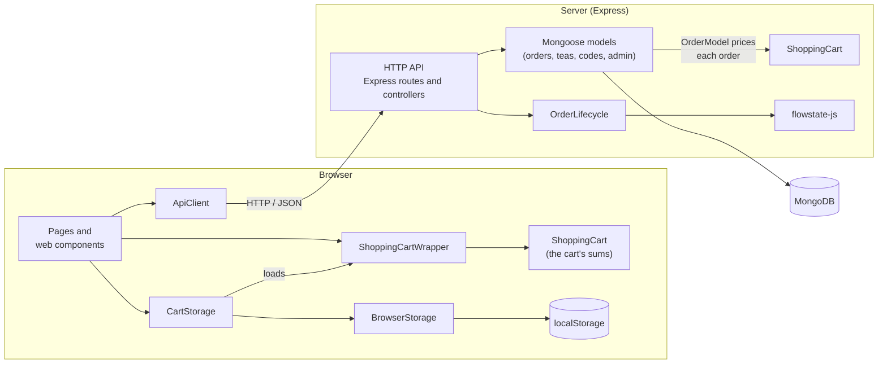
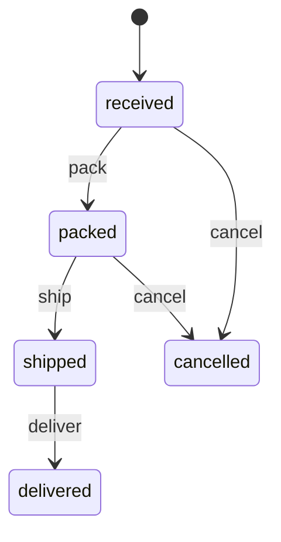

# Tea Shop

A small tea webshop. Customers fill a cart, place an order and track it. An admin moves each order from received to
delivered. It is a demo: no payment is made and no tea is sent.

The shop uses two modules: my own state machine [flowstate-js](https://github.com/Abbas288/flowstate-js) for the
order's lifecycle, and another student's [ShoppingCart](https://github.com/rosa24-bth/1DV610-laboration-2) for the
cart and its prices.

## Try the shop

The public demo runs on Cumulus over HTTPS.

**Shop address:** [Open Tea Shop](https://cu3133.camp.lnu.se/1dv610/tea-shop/).

## Status

The results below are dated **2026-10-21**.

| Part                  | State                                                                    |
| --------------------- | ------------------------------------------------------------------------ |
| R1–R11, R13           | Done and tested, see [TEST_REPORT.md](TEST_REPORT.md).                   |
| R12: HTTPS on Cumulus | Passed. See [Cumulus verification](TEST_REPORT.md#cumulus-verification). |

**The admin page:** scroll to the bottom of the shop and follow **Admin** in the footer, on the right on desktop.
The link opens the login page. The course's examiners receive the test account's login privately in the submission;
other visitors can ask me for access to the demo account. When you [run the shop locally](#run-locally), you choose
the admin's login in `.env`.

## Vision

Buying tea online should take a minute, and the customer should always know where the order is. The shop shows four
teas, adds up the cart with a discount code, and lets the customer follow the order with its number and email address.
The admin can only move an order the way an order really moves, and can undo mistakes.

## Requirements

**Note:** In the table below, ShoppingCart is another student's module for managing the cart and calculating totals
and discounts.
flowstate-js is the state machine module I developed, used for order statuses and undo.

| ID                    | Requirement                                                                                                                                                                                           | Carried by                   |
| --------------------- | ----------------------------------------------------------------------------------------------------------------------------------------------------------------------------------------------------- | ---------------------------- |
| R1                    | The customer sees the shop's four teas, each with a name, a picture, a short description and a price.                                                                                                 | Server, MongoDB              |
| R2                    | The customer can add teas, change the number of bags (a whole number from 1 to 99 per tea) and remove teas. The cart stays after a reload.                                                            | ShoppingCart, `localStorage` |
| R3                    | The customer can enter the code `SAVE10` and get 10% off. An unknown code gets a message.                                                                                                             | ShoppingCart, server         |
| R4                    | The cart shows the right subtotal, discount and total.                                                                                                                                                | ShoppingCart                 |
| R5                    | The checkout needs a name, an email address and a delivery address. Bad details and an empty cart are refused, in the browser and on the server.                                                      | Browser, `OrderModel`        |
| R6                    | The server prices the order with its own prices and checks the code itself. Prices from the browser are not used.                                                                                     | ShoppingCart on the server   |
| R7                    | After the order, the customer gets an order number and a link to the tracking page. The cart is emptied only when the server has saved the order.                                                     | Server, MongoDB              |
| R8                    | With the order number and the email address, the customer sees the status, the steps done and left, and when the status changed, but no customer details. A wrong number or address gets "not found". | flowstate-js                 |
| R9                    | The admin can log in and out. The admin page and the admin's API need a login, also when the API is called directly.                                                                                  | Server, sessions             |
| <a name="r10"></a>R10 | The admin sees all orders, opens one and can only change its status to an allowed next step. The latest change can be undone, step by step.                                                           | flowstate-js                 |
| R11                   | An order can be cancelled while its status is received or packed.                                                                                                                                     | flowstate-js                 |
| R12                   | The shop is reached over HTTPS on Cumulus, and the orders stay after a restart of the server.                                                                                                         | MongoDB, deployment          |
| R13                   | The shop shows clearly that it is a demo.                                                                                                                                                             | Shop and checkout pages      |

Each requirement has at least one test case in [TEST_REPORT.md](TEST_REPORT.md).

## How it fits together

The main dependencies are shown below.



- **The browser** shows each page with web components (Shadow DOM). The cart lives in `localStorage`, and
  ShoppingCart adds it up.
- **The server** is an Express app. It prices every order again with its own prices, so the browser's sums are only
  a preview (R6).
- **flowstate-js** decides which status changes are allowed. For admin order details and status changes,
  `OrderLifecycle` rebuilds the undo history from the order's saved status and events.
- **Admin login** is remembered in the server's temporary working memory (RAM). An app restart clears that memory,
  so the admin must log in again. Orders and their history stay saved in MongoDB (R12).

### An order's lifecycle

The diagram shows forward events. Undo reverses the latest recorded change, one step at a time.



| What the app needs                            | flowstate-js                     |
| --------------------------------------------- | -------------------------------- |
| Available next status changes ([R10](#r10))   | `listEventNamesFrom`             |
| Change status or reject an invalid transition | `send`, `NoTransitionError`      |
| Undo the latest change ([R10](#r10))          | `history`, `undoLastMove`        |
| Restore undo history from saved events        | `canSend`, `send`                |
| Calculate the tracking steps                  | `findPathTo`, `canReach`, `send` |

Tracking calculates completed steps along the shortest path from received to the current status. A cancelled order
therefore shows received and cancelled, even if it was packed first. Remaining steps lead to delivered; a cancelled
order has none.

### Pages

| Address        | What it does                                                                 |
| -------------- | ---------------------------------------------------------------------------- |
| `/`            | The shop: the four teas. Clicking a tea adds a bag to the cart.              |
| `/cart`        | The cart: bags per tea, the discount code and the sums.                      |
| `/checkout`    | Delivery details and the order.                                              |
| `/thankyou`    | The receipt with the order number.                                           |
| `/track`       | Tracking with the order number and the email address.                        |
| `/admin-login` | The admin's login.                                                           |
| `/admin`       | The admin's orders, only after login. Anyone else is sent to `/admin-login`. |

### API

| Method and path                         | Who    | Answer                                                                                                                 |
| --------------------------------------- | ------ | ---------------------------------------------------------------------------------------------------------------------- |
| `GET /api/products`                     | anyone | 200 with the four teas, sorted by name.                                                                                |
| `GET /api/discount-codes/:code`         | anyone | 200 with the code and percent; 404 if the code is unknown.                                                             |
| `POST /api/orders`                      | anyone | 201 with `{ "number": … }`; 400 for invalid order data.                                                                |
| `POST /api/orders/:number/tracking`     | anyone | 200 with number, status, time and steps for `{ "email": … }`; 404 for an unknown order or a wrong or missing email.    |
| `POST /api/admin/login`                 | anyone | 200 with the admin's email and a new session cookie; 401 for incorrect or missing credentials.                         |
| `POST /api/admin/logout`                | anyone | 204 with no response body. Also works when already signed out.                                                         |
| `GET /api/admin/orders`                 | admin  | 200 with order summaries, newest first.                                                                                |
| `GET /api/admin/orders/:number`         | admin  | 200 with the order's customer details, teas, totals, allowed next events and latest event.                             |
| `POST /api/admin/orders/:number/events` | admin  | 200 with the updated order for `{ "event": "pack" }`; 400 for a missing or unknown event, 409 for a disallowed change. |
| `POST /api/admin/orders/:number/undo`   | admin  | 200 with the restored order; 409 if no saved change can be undone.                                                     |

Every route under `/api/admin/orders` returns 401 without an admin session. With a session, routes containing
`:number` return 404 if the order does not exist. API errors return `{ "status": …, "message": … }`.

### Security measures

| Risk                                                     | What the shop does                                                                                                                                        |
| -------------------------------------------------------- | --------------------------------------------------------------------------------------------------------------------------------------------------------- |
| A changed price in the browser                           | The server prices every order with its own prices (R6).                                                                                                   |
| Code typed into a name or an address                     | Customer details are inserted with `textContent`. Helmet's CSP blocks inline scripts.                                                                     |
| MongoDB query-operator injection, e.g. `{ "$ne": null }` | Backend code requires strings for login-email and discount-code lookups and builds MongoDB filters explicitly. Tracking compares the email in JavaScript. |
| A stolen or forged session                               | The cookie is `HttpOnly` and `SameSite=Strict`, `Secure` in production, and the session id changes at login.                                              |
| A leaked password                                        | The admin's password is stored as a bcrypt hash.                                                                                                          |
| Guessing which orders exist                              | Tracking gives the same 404 for a wrong number and a wrong email address.                                                                                 |

Not done: a limit on login attempts and on tracking attempts. See _Not tested_ in the test report.

## Run locally

You need Node.js 22.12 or later, and a MongoDB database (local, in Docker, or a free cluster on MongoDB Atlas).

```bash
git clone https://github.com/Abbas288/tea-shop.git
cd tea-shop
npm install
cp .env.example .env    # then fill in the values below
npm start               # or npm run dev, which restarts on changes
```

The shop runs at `http://localhost:3000`. At start, the server writes the teas, the discount code and the admin into
the database.

| Variable               | Example                              | What it is                                           |
| ---------------------- | ------------------------------------ | ---------------------------------------------------- |
| `PORT`                 | `3000`                               | The port the server listens on.                      |
| `NODE_ENV`             | `development`                        | `production` turns on secure cookies behind a proxy. |
| `DB_CONNECTION_STRING` | `mongodb://localhost:27017/tea-shop` | The database.                                        |
| `SESSION_NAME`         | `tea-shop.sid`                       | The name of the session cookie.                      |
| `SESSION_SECRET`       | a long random string                 | Signs the session cookie.                            |
| `ADMIN_EMAIL`          | `admin@example.se`                   | The admin's email address.                           |
| `ADMIN_PASSWORD`       | at least 10 characters               | The admin's password, saved hashed.                  |

The server stops with a message if `DB_CONNECTION_STRING`, `SESSION_SECRET`, `ADMIN_EMAIL` or `ADMIN_PASSWORD` is
missing.

### Tests and code quality

```bash
npm test          # 135 tests; the integration tests start their own MongoDB in memory
npm run lint      # ESLint with @lnu/eslint-config
npm run format    # Prettier
```

The tests never read `.env`. How each requirement was tested is in [TEST_REPORT.md](TEST_REPORT.md), and one order from
the shop to delivered is in [E2E_TEST.md](E2E_TEST.md).

## Project structure

```text
src/
  server.js, app.js      start the server, put Express together
  config/                database, seeding, session options
  constants/             order statuses and events, order rules
  controllers/           one per resource: products, discount codes, orders, admin
  middlewares/           ErrorHandler, AdminGuard
  models/                mongoose models, OrderLifecycle (flowstate-js), StatusChangeError
  routes/                one router per resource, /api and the admin page
  views/admin.html       the admin page, only sent after login
  data/                  the teas and the discount code
public/
  *.html                 the shop's pages
  js/pages/              one class per page that has logic (the thank-you page needs none)
  js/components/         web components, each with a README
  js/model/              the cart: ShoppingCartWrapper, CartLine, Product
  js/services/           ApiClient, CartStorage, BrowserStorage
  css/                   our own rules: shop.css, admin.css
  images/                the teas and the cup, with their credits
  vendor/                Furni and Bootstrap's examples, unchanged
test/                    unit tests, browser classes with fakes, integration tests over HTTP
```

## Credits

| What                               | By                                                                                                                            | License                                                         |
| ---------------------------------- | ----------------------------------------------------------------------------------------------------------------------------- | --------------------------------------------------------------- |
| Shop template Furni                | Untree.co, distributed by ThemeWagon                                                                                          | [CC BY 3.0](https://creativecommons.org/licenses/by/3.0/)       |
| Admin pages: Sign-in and Dashboard | Bootstrap's official examples (5.1.3)                                                                                         | [MIT](https://github.com/twbs/bootstrap/blob/v5.1.3/LICENSE)    |
| Tea photos                         | soultea.de / André Helbig, Wikimedia Commons; background removed and cropped, see [CREDITS.md](public/images/teas/CREDITS.md) | [CC BY-SA 3.0](https://creativecommons.org/licenses/by-sa/3.0/) |
| The cup in the shop's hero         | Auckland Museum, Wikimedia Commons; background removed and cropped, see [CREDITS.md](public/images/CREDITS.md)                | [CC BY 4.0](https://creativecommons.org/licenses/by/4.0/)       |
| ShoppingCart                       | Robin Sanssi (`rosa24-bth`), another student in 1DV610                                                                        | ISC                                                             |
| flowstate-js                       | Me, the author                                                                                                                | MIT                                                             |

## License

MIT, see [LICENSE](LICENSE). The template, the photos and the other module keep their own licenses, listed above.
